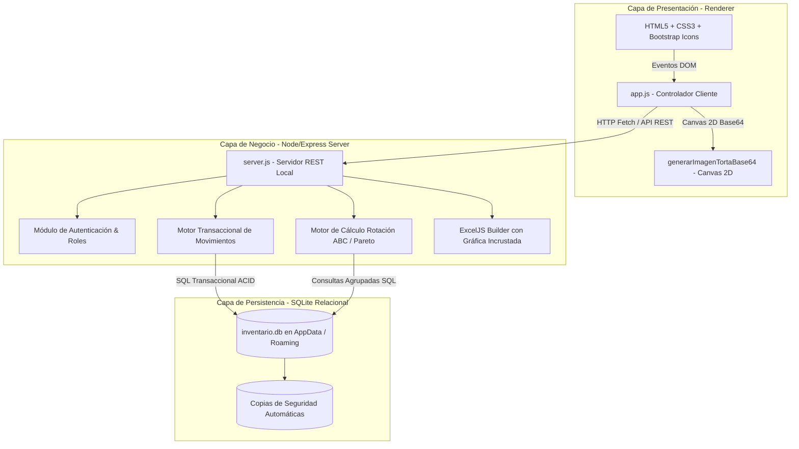

# 🏛️ ARQUITECTURA TÉCNICA Y DISEÑO DEL SISTEMA - INVENTARIO CDS

**Versión:** 1.5.0  
**Stack Principal:** Electron 44.0.0, Node.js, Express.js, SQLite3, ExcelJS, HTML5/CSS3/Vanilla JS.

---

## 1. Visión General de la Arquitectura

El sistema implementa una arquitectura desacoplada de escritorio en tres capas:



---

## 2. Componentes Principales

### 🖥️ 1. Proceso Principal (`main.js`):
- Inicializa la ventana nativa de Electron (`BrowserWindow`).
- Configura las rutas de persistencia permanente en `%APPDATA%\INVENTARIO CDS\`.
- Si no existe la base de datos en AppData, realiza la migración/inicialización desde la plantilla base.
- Levanta el servidor Express en segundo plano en el puerto local asignado.
- Maneja eventos de ciclo de vida de la aplicación de escritorio.

### 🌐 2. Servidor de Negocio y API REST (`src/api/server.js`):
- Expone servicios HTTP REST bajo el prefijo `/api/`.
- Realiza validaciones estrictas de tipos de datos, llaves foráneas y reglas de negocio.
- Maneja transacciones SQL (`BEGIN TRANSACTION`, `COMMIT`, `ROLLBACK`) para garantizar consistencia atómica en los movimientos.
- Genera libros de trabajo complejos en memoria con `ExcelJS` e incrusta imágenes en alta definición.

### 🎨 3. Interfaz de Usuario y Controlador (`src/public/js/app.js`):
- Arquitectura SPA (*Single Page Application*) ligera sin dependencias de frameworks pesados (Vanilla JS puro para máxima velocidad y bajo consumo de memoria RAM).
- Gestión del estado global de la aplicación (`appState`): usuario en sesión, sede activa, tipo de inventario y catálogo en memoria.
- Generador de gráficos Donut en Canvas 2D independiente (`generarImagenTortaBase64`).

---

## 3. Algoritmo de Clasificación ABC (Pareto) y Rotación

El motor de rotación evalúa la totalidad de referencias en el período seleccionado aplicando el principio de Pareto:

### 📐 Pasos del Algoritmo:
1. **Recolección de Salidas:** Se consultan todas las transacciones de salida (`ENTREGA` y `DISPOSICION FINAL`) agrupadas por ítem en el rango de fechas.
2. **Cálculo de Consumo Total Global:**
   $$\text{TotalSalidasGlobal} = \sum \text{Salidas de todos los ítems}$$
3. **Ordenamiento Descendente:** Se ordenan todos los ítems de mayor a menor según sus salidas totales.
4. **Porcentaje de Participación y Acumulado:**
   $$\text{PctParticipacion}_i = \left( \frac{\text{Salidas}_i}{\text{TotalSalidasGlobal}} \right) \times 100$$
   $$\text{PctAcumulado}_i = \sum_{k=1}^{i} \text{PctParticipacion}_k$$
5. **Asignación de Zonas:**
   - Si $\text{Salidas}_i = 0$:
     - Si $\text{StockActual}_i > 0 \rightarrow$ **Zona D (Sin Rotación / Inactivo)**.
     - Si $\text{StockActual}_i = 0 \rightarrow$ **Zona E (Sin Movimiento)**.
   - Si $\text{PctAcumulado}_i \le 80\% \rightarrow$ **Zona A (Alta Rotación)**.
   - Si $80\% < \text{PctAcumulado}_i \le 95\% \rightarrow$ **Zona B (Media Rotación)**.
   - Si $\text{PctAcumulado}_i > 95\% \rightarrow$ **Zona C (Baja Rotación)**.

---

## 4. Renderizado Autónomo de la Gráfica de Torta en Excel

Para evitar fallos por contenedores ocultos (`display: none`) o retrasos de animación en Chart.js:
1. Se implementó la función síncrona `generarImagenTortaBase64(resumen, data)`.
2. Crea un elemento `<canvas>` fuera de pantalla con resolución de **800x460 píxeles**.
3. Dibuja sobre el contexto 2D:
   - Fondo sólido blanco `#FFFFFF` (evita artefactos oscuros de transparencia en Excel).
   - Banner superior con título y criterio de Pareto.
   - Anillo Donut con arcos proporcionales y separadores blancos de 3px.
   - Contador central destacado con el total de referencias evaluadas.
   - Cuadrantes de leyenda en el lateral derecho con insignias de color, número de ítems, porcentajes y unidades despachadas.
4. Devuelve la imagen codificada en `data:image/png;base64,...`.
5. El backend recibe el Base64, lo decodifica a un `Buffer` binario y lo incrusta mediante `workbook.addImage()` en la celda `B14` de la Hoja 1 de Excel.

---

## 5. Estrategia de Persistencia y Seguridad

- **Ubicación de la Base de Datos:**
  ```text
  %APPDATA%\INVENTARIO CDS\inventario.db
  ```
- **Integridad Referencial:** Llaves foráneas (`PRAGMA foreign_keys = ON;`) y validaciones de unicidad en código de ítem y número de cédula de usuario.
- **Transacciones Seguras:** Los movimientos de tipo `TRASLADO` ejecutan validación simultánea en bodegas origen y destino dentro del mismo bloque transaccional.
