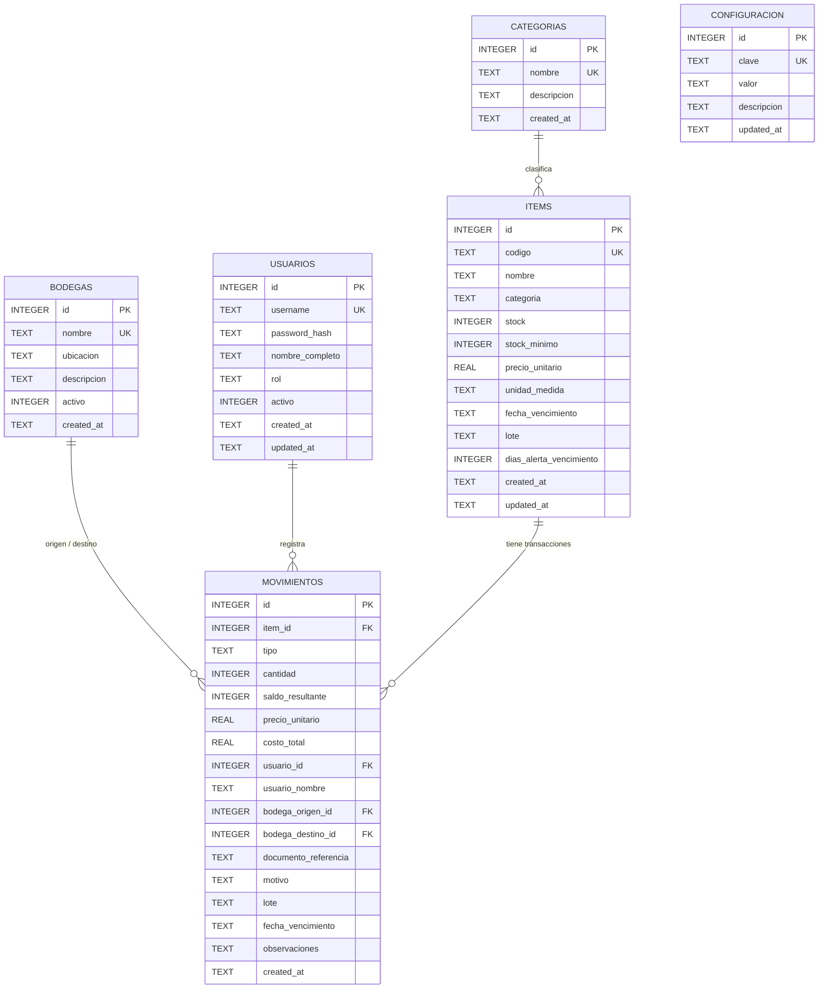

# Diccionario de Datos y Modelo de Base de Datos - INVENTARIO CDS

## 1. Visión General del Motor de Persistencia

El sistema **INVENTARIO CDS** utiliza **SQLite 3** como motor de base de datos embebido y autónomo. No requiere servicios externos (como MySQL o PostgreSQL), lo que permite una ejecución local de alto rendimiento con soporte completo para transacciones **ACID** (Atomicidad, Consistencia, Aislamiento y Durabilidad).

### Ubicación del Archivo de Base de Datos
- **Entorno de Producción (Instalador / Portable):**
  `%APPDATA%\INVENTARIO CDS\inventario.db` (en Windows: `C:\Users\<Usuario>\AppData\Roaming\INVENTARIO CDS\inventario.db`)
- **Entorno de Desarrollo:**
  `D:\antigravity\INVENTARIO\inventario.db` (fallback al directorio raíz del proyecto)

---

## 2. Diagrama Entidad-Relación Lógico (ERD)



---

## 3. Especificación Detallada de Tablas

### 3.1. Tabla: `items` (Catálogo de Artículos y Stock Global)
Almacena el catálogo maestro de referencias de inventario, existencias actuales, costos y parámetros de alertas de vencimiento.

| Campo | Tipo | Nulo | Por Defecto | Descripción / Reglas de Negocio |
| :--- | :--- | :---: | :---: | :--- |
| `id` | `INTEGER` | NO | AUTOINCREMENT | Identificador único primario (PK). |
| `codigo` | `TEXT` | NO | - | Código alfanumérico único (SKU / Código de Barras). `UNIQUE`. |
| `nombre` | `TEXT` | NO | - | Nombre descriptivo del producto o material. |
| `categoria` | `TEXT` | SÍ | `'General'` | Nombre de la categoría a la que pertenece. |
| `stock` | `INTEGER` | NO | `0` | Existencia física consolidada disponible. |
| `stock_minimo` | `INTEGER` | NO | `5` | Umbral para disparo de alertas de reposición. |
| `precio_unitario` | `REAL` | NO | `0.0` | Costo/Precio base de adquisición por unidad monetaria ($). |
| `unidad_medida` | `TEXT` | SÍ | `'UND'` | Unidad física de conteo (UND, KG, LT, MTS, CAJA). |
| `fecha_vencimiento` | `TEXT` | SÍ | `NULL` | Fecha de caducidad en formato ISO (`YYYY-MM-DD`). |
| `lote` | `TEXT` | SÍ | `NULL` | Identificador de lote de fabricación / trazabilidad. |
| `dias_alerta_vencimiento` | `INTEGER` | NO | `30` | Ventana previa en días para clasificar en "Próximos a Vencer". |
| `created_at` | `TEXT` | NO | `CURRENT_TIMESTAMP` | Fecha y hora de creación del registro. |
| `updated_at` | `TEXT` | NO | `CURRENT_TIMESTAMP` | Fecha y hora de la última modificación. |

---

### 3.2. Tabla: `movimientos` (Libro Mayor / Transacciones de Kardex)
Registra cada evento de entrada, salida, ajuste o traslado inter-bodega. Funciona como un ledger inmutable que sustenta el cálculo de auditoría.

| Campo | Tipo | Nulo | Por Defecto | Descripción / Reglas de Negocio |
| :--- | :--- | :---: | :---: | :--- |
| `id` | `INTEGER` | NO | AUTOINCREMENT | Identificador único de transacción (PK). |
| `item_id` | `INTEGER` | NO | - | Llave foránea hacia `items(id)`. |
| `tipo` | `TEXT` | NO | - | Tipo de movimiento: `'ENTRADA'`, `'SALIDA'`, `'AJUSTE'`, `'TRASLADO'`. |
| `cantidad` | `INTEGER` | NO | - | Magnitud de unidades involucradas (siempre positivo). |
| `saldo_resultante`| `INTEGER` | NO | `0` | Balance del ítem tras el impacto de la transacción. |
| `precio_unitario` | `REAL` | NO | `0.0` | Costo unitario registrado en el momento de la transacción. |
| `costo_total` | `REAL` | NO | `0.0` | Subtotal monetario (`cantidad * precio_unitario`). |
| `usuario_id` | `INTEGER` | SÍ | `NULL` | ID del operador responsable (`usuarios.id`). |
| `usuario_nombre` | `TEXT` | SÍ | `NULL` | Nombre del usuario registrado en texto histórico. |
| `bodega_origen_id` | `INTEGER` | SÍ | `NULL` | Bodega desde donde egresa la mercancía. |
| `bodega_destino_id`| `INTEGER` | SÍ | `NULL` | Bodega hacia donde ingresa la mercancía. |
| `documento_referencia` | `TEXT` | SÍ | `NULL` | Número de factura, remisión o comprobante externo. |
| `motivo` | `TEXT` | SÍ | `NULL` | Razón funcional (ej. "Compra", "Venta", "Merma", "Picking"). |
| `lote` | `TEXT` | SÍ | `NULL` | Lote de la mercancía transada. |
| `fecha_vencimiento`| `TEXT` | SÍ | `NULL` | Caducidad asociada al movimiento. |
| `observaciones` | `TEXT` | SÍ | `NULL` | Notas adicionales ingresadas por el operador. |
| `created_at` | `TEXT` | NO | `CURRENT_TIMESTAMP` | Marca temporal exacta de la transacción. |

---

### 3.3. Tabla: `usuarios` (Autenticación y Control de Accesos)
Almacena las credenciales y perfiles de los operadores del software.

| Campo | Tipo | Nulo | Por Defecto | Descripción |
| :--- | :--- | :---: | :---: | :--- |
| `id` | `INTEGER` | NO | AUTOINCREMENT | Identificador de usuario (PK). |
| `username` | `TEXT` | NO | - | Nombre de usuario único para login. `UNIQUE`. |
| `password_hash` | `TEXT` | NO | - | Hash de contraseña con salt (SHA-256 / bcrypt). |
| `nombre_completo` | `TEXT` | NO | - | Nombre y apellido del colaborador. |
| `rol` | `TEXT` | NO | `'operador'` | Rol del sistema: `'administrador'` u `'operador'`. |
| `activo` | `INTEGER` | NO | `1` | `1` = Usuario activo, `0` = Inactivo / Suspendido. |
| `created_at` | `TEXT` | NO | `CURRENT_TIMESTAMP` | Fecha de alta del usuario. |
| `updated_at` | `TEXT` | NO | `CURRENT_TIMESTAMP` | Última actualización de perfil. |

---

### 3.4. Tabla: `bodegas` (Ubicaciones y Sedes)
Gestión de bodegas físicas, sedes o centros de almacenamiento para control multisede.

| Campo | Tipo | Nulo | Por Defecto | Descripción |
| :--- | :--- | :---: | :---: | :--- |
| `id` | `INTEGER` | NO | AUTOINCREMENT | ID primario (PK). |
| `nombre` | `TEXT` | NO | - | Nombre único de la bodega (ej. "Bodega Central", "Punto Norte"). |
| `ubicacion` | `TEXT` | SÍ | `NULL` | Dirección o sector dentro de la planta. |
| `descripcion` | `TEXT` | SÍ | `NULL` | Propósito u observaciones de la sede. |
| `activo` | `INTEGER` | NO | `1` | Estado operativo (`1` = Activa, `0` = Inactiva). |
| `created_at` | `TEXT` | NO | `CURRENT_TIMESTAMP` | Fecha de creación. |

---

### 3.5. Tabla: `categorias` (Agrupación de Artículos)
Clasificación taxonómica de las referencias para filtrado y reportes.

| Campo | Tipo | Nulo | Por Defecto | Descripción |
| :--- | :--- | :---: | :---: | :--- |
| `id` | `INTEGER` | NO | AUTOINCREMENT | ID de categoría (PK). |
| `nombre` | `TEXT` | NO | - | Nombre de la categoría (ej. "Electrónica", "Papelería"). `UNIQUE`. |
| `descripcion` | `TEXT` | SÍ | `NULL` | Detalle o alcance del grupo. |
| `created_at` | `TEXT` | NO | `CURRENT_TIMESTAMP` | Fecha de registro. |

---

### 3.6. Tabla: `configuracion` (Variables Globales de Entorno)
Tabla de pares clave-valor para parámetros operacionales de la empresa.

| Campo | Tipo | Nulo | Por Defecto | Descripción |
| :--- | :--- | :---: | :---: | :--- |
| `id` | `INTEGER` | NO | AUTOINCREMENT | ID primario (PK). |
| `clave` | `TEXT` | NO | - | Clave única de configuración (ej. `'EMPRESA_NOMBRE'`). `UNIQUE`. |
| `valor` | `TEXT` | SÍ | `NULL` | Valor asignado al parámetro. |
| `descripcion` | `TEXT` | SÍ | `NULL` | Nota explicativa de la variable. |
| `updated_at` | `TEXT` | NO | `CURRENT_TIMESTAMP` | Fecha de última modificación. |

---

## 4. Índices para Optimización de Consultas

Para asegurar respuestas sub-milisegundo en catálogos extensos (> 50,000 referencias), se aplican los siguientes índices B-Tree:

```sql
-- Búsqueda rápida por código de ítem
CREATE INDEX IF NOT EXISTS idx_items_codigo ON items(codigo);

-- Búsqueda por categoría y estado de stock
CREATE INDEX IF NOT EXISTS idx_items_categoria ON items(categoria);
CREATE INDEX IF NOT EXISTS idx_items_vencimiento ON items(fecha_vencimiento);

-- Historial de transacciones de Kardex por fecha e ítem
CREATE INDEX IF NOT EXISTS idx_movimientos_item_id ON movimientos(item_id);
CREATE INDEX IF NOT EXISTS idx_movimientos_tipo ON movimientos(tipo);
CREATE INDEX IF NOT EXISTS idx_movimientos_created_at ON movimientos(created_at);
CREATE INDEX IF NOT EXISTS idx_movimientos_item_fecha ON movimientos(item_id, created_at);
```

---

## 5. Estrategia de Copias de Seguridad y Mantenimiento

1. **Backup en Caliente (VACUUM INTO):**
   SQLite permite crear un clon binario atómico e íntegro mediante el comando:
   ```sql
   VACUUM INTO 'C:/Backups/inventario_backup_2026-09-19.db';
   ```
2. **Compactación Periódica:**
   Se ejecuta `PRAGMA optimize;` y `VACUUM;` durante el mantenimiento del sistema para desfragmentar páginas B-Tree y recuperar espacio en disco.
