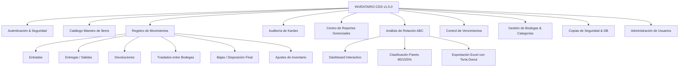

# 📚 CENTRO DE DOCUMENTACIÓN OFICIAL - SISTEMA INVENTARIO CDS

**Versión del Sistema:** 1.5.0  
**Plataforma:** Windows Desktop (x64)  
**Arquitectura:** Electron + Node.js / Express + SQLite3 + ExcelJS + Vanilla JS  
**Fecha de Actualización:** Septiembre 2026  

---

## 🎯 Propósito del Proyecto
**INVENTARIO CDS** es una solución empresarial de escritorio diseñada para la administración física, trazabilidad transaccional (Kardex), control de caducidad/lotes y análisis estratégico de rotación (Pareto ABC) de materiales, herramientas, repuestos y suministros corporativos.

El sistema opera de forma **100% autónoma y offline** (sin depender de internet para sus operaciones diarias), con persistencia de datos relacional y respaldos automáticos en `AppData\Roaming\INVENTARIO CDS`.

---

## 📑 Estructura de la Documentación

Esta carpeta reúne la documentación técnica, funcional y de desarrollo completa del proyecto:

| Archivo | Contenido / Audiencia |
| :--- | :--- |
| [01_MANUAL_DE_USUARIO.md](./01_MANUAL_DE_USUARIO.md) | **Guía Funcional Completa**: Manual paso a paso para operadores, almacenistas y administradores. |
| [02_ARQUITECTURA_Y_DISENO_TECNICO.md](./02_ARQUITECTURA_Y_DISENO_TECNICO.md) | **Arquitectura Técnica**: Estructura de Electron, API Express, algoritmo de rotación ABC y motor de reportes. |
| [03_DICCIONARIO_DE_DATOS_Y_BD.md](./03_DICCIONARIO_DE_DATOS_Y_BD.md) | **Base de Datos SQLite**: Diagrama relacional, tablas, campos, tipos, índices y disparadores (triggers). |
| [04_GUIA_DESPLIEGUE_Y_COMPILACION.md](./04_GUIA_DESPLIEGUE_Y_COMPILACION.md) | **DevOps & Build**: Procedimiento para compilar instaladores NSIS y ejecutables portables. |
| [05_API_REST_ENDPOINTS.md](./05_API_REST_ENDPOINTS.md) | **Referencia de API**: Catálogo detallado de todas las rutas HTTP locales (`GET`, `POST`, `PUT`, `DELETE`). |

---

## 🚀 Resumen de Módulos del Sistema

---

## 📌 Datos de Contacto y Repositorio
- **Repositorio Git:** `https://github.com/WILORTIZ/inventario-de-escritorio-.git`
- **Rama Principal:** `main`
- **Ambiente de Ejecución:** Windows 10 / Windows 11 (64-bit)
